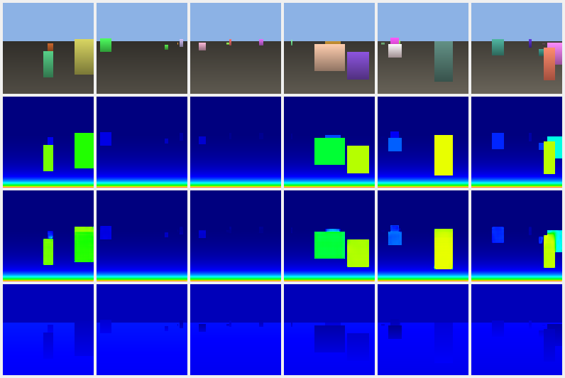

# AMD GPU Lab

Experiments around machine learning and low-level GPU work on an AMD Radeon
RX 7900 XTX (RDNA 3, ROCm) — making CUDA-only software run on AMD, writing a
rasterizer on three levels down to GPU assembly, collecting GPU telemetry and
training small models on it.

This is a research workbench, not a product: some parts work well, others are
proofs of concept. Each part says which.

## Parts

### `cuda_shim/` – CUDA on AMD at runtime (C++)
A drop-in `libcuda` replacement that translates CUDA Runtime and Driver API
calls, NVRTC and nvJitLink to HIP while the program runs, so CUDA binaries can
execute on an AMD GPU. Includes native CUDA, translated HIP and shimmed test
programs for comparison.

### `cuda_translator/` – CUDA → HIP source translation
- `hybrid_translator.py` – rules for known APIs plus an ML fallback for the
  rest.
- `translator_model.py`, `transformer_model.py` – small seq2seq transformer
  (4.3 M parameters) trained on CUDA↔HIP pairs. Honest result
  ([`RESULTS.md`](cuda_translator/RESULTS.md)): with 32 training pairs it
  learned the pattern (`cuda…` → `hip…`) but not exact translations yet.
- `cuda_to_hip_pipeline.py` – end-to-end pipeline around it.

### `gpu_rasterization/` – a rasterizer on three levels
The same triangle rasterizer as **HIP**, **OpenCL** and hand-written
**GCN/RDNA assembly** (`kernels/`). While rasterizing, a collector stores
per-pixel training features in HDF5 — barycentric weights, depth, normalized
screen position, coverage — with a `feature_names` attribute so loaders know
the columns. Can also collect while games are running.

### `depth_perception/` – depth from a single image, self-taught
Idea: the forward direction (3D scene → image + exact depth) is easy and
deterministic, so the rasterizer generates unlimited `(RGB, depth)` pairs, and
a small U-Net (1.93 M parameters) learns the hard backward direction
(image → depth). No manual labels.

| method | validation MAE |
|---|---|
| naive brightness → depth (best affine fit) | 0.168 |
| learned U-Net | **0.0025** (~67× better) |



Measured on generated scenes; the step to real photos (domain gap) is the open
next step.

### `amd_compat/` – ML libraries on ROCm
Shims that let NVIDIA-first libraries run on AMD: a `bitsandbytes` (8/4-bit
quantization) compatibility layer, Flash Attention replaced by PyTorch SDPA,
an SDPA attention processor for Qwen image models, aggressive dynamic
offloading for large diffusion pipelines, and a VRAM memory guard.

### GPU telemetry and performance counters
- `scripts/` – instrumenting AMD **GPUPerfAPI** counters into Vulkan/DX
  samples (AMD Render Pipeline Shaders), parsing and exporting counters,
  deriving counter formulas, ADLX device info, labelling traces, turning
  counter CSVs into datasets, telemetry training with a time budget.
- `tools/` – small C++ helpers for GPUPerfAPI (list counters, instrument
  samples).
- `gpu_data_collector.py`, `run_sdnext_with_data_collection.py` – run GPU
  workloads (e.g. Stable Diffusion via SD.Next) while recording `rocm-smi`
  metrics and timing.
- `gpu_service/` – a distributed collector that colleagues can run on their
  own AMD machines to contribute data.
- `train_contrastive.py`, `model.py`, `scheduler.py` – a contrastive encoder
  that turns GPU workload logs into embeddings.

## Setup

Linux with ROCm 6.x, or Windows for the telemetry scripts.

```bash
python -m venv .venv && source .venv/bin/activate
pip install -r requirements.txt          # + a ROCm build of PyTorch
python -m pytest tests/test_windows*      # content-only tests, no GPU needed
```

The rest of the test suite needs a ROCm GPU and the collected data, which is
not part of the repository. Paths in some shell scripts assume
`/home/user/Dokumente/Projekte/AmdGpudrive`.

Most comments and notes are in German.

## Tech

Python · PyTorch (ROCm) · HIP · OpenCL · GCN/RDNA assembly · C++ · CUDA ·
GPUPerfAPI · ADLX · rocm-smi · HDF5 / Parquet
